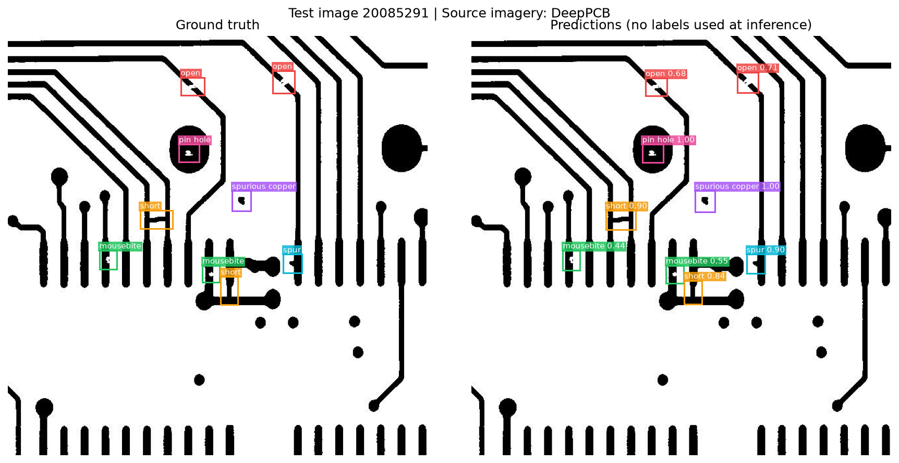
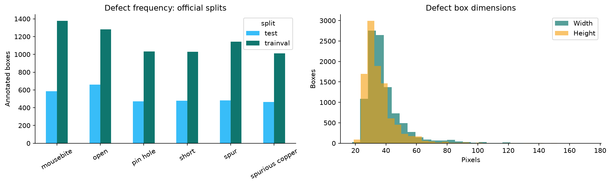
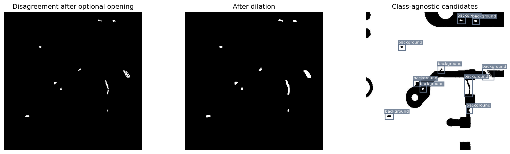
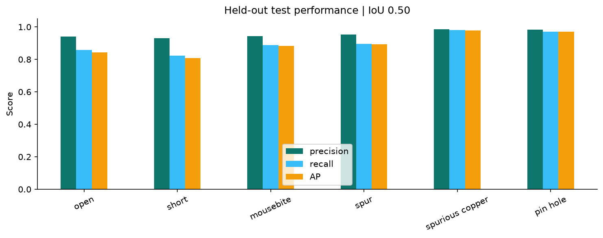
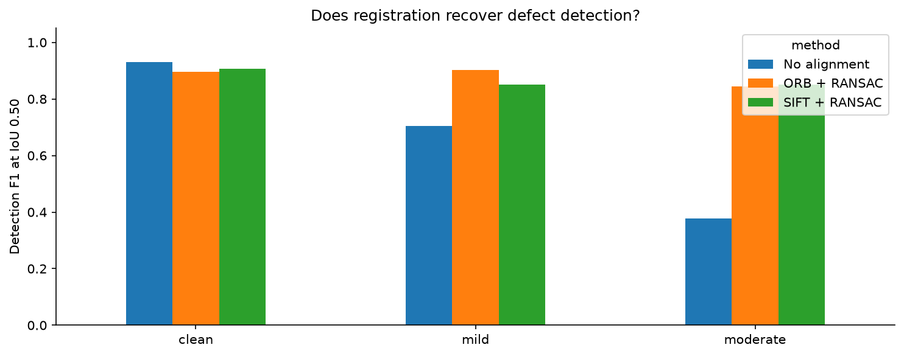
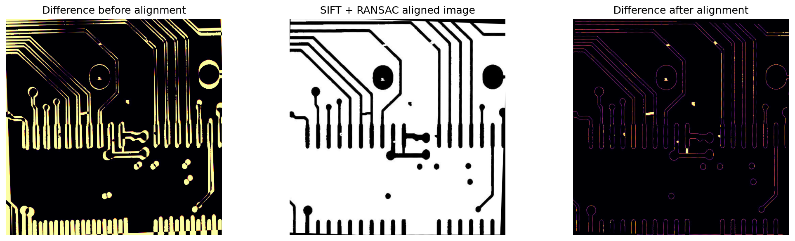
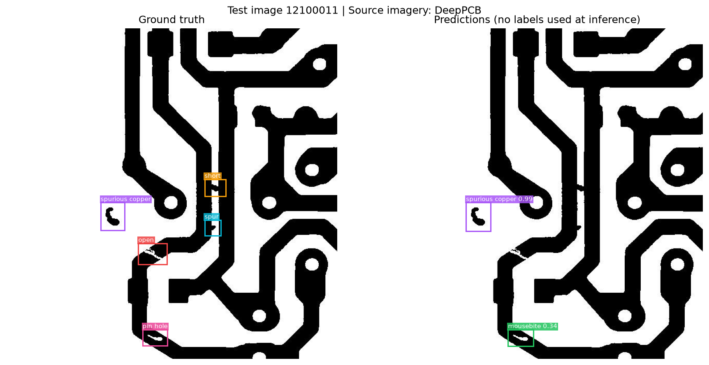
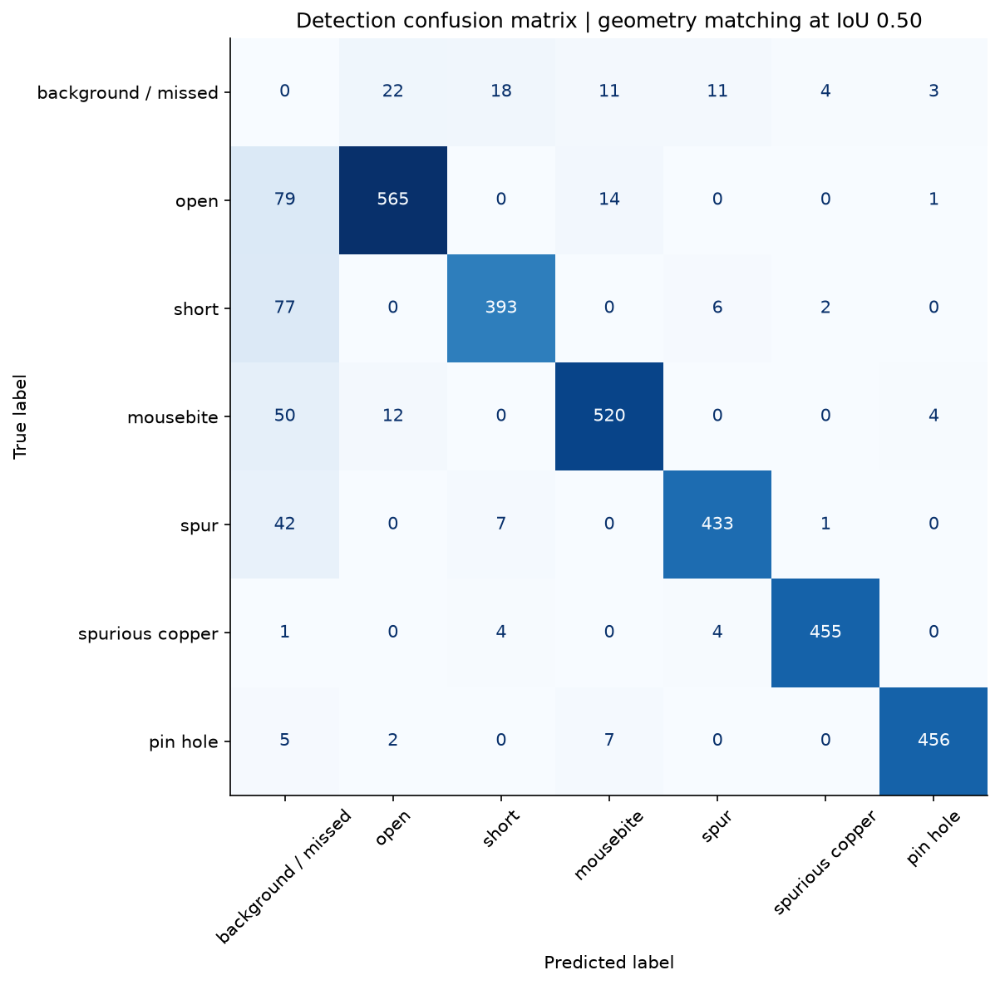

# DeepPCB Visual Inspection

**An explainable, CPU-only computer vision project for circuit-board defect detection.**

Compare an inspected PCB with its defect-free reference, localise defects, classify six defect types,
and measure how ORB/SIFT registration handles camera misalignment. Built for Computer Vision for AI coursework.

[Open the executed notebook](DeepPCB_Inspection.ipynb) · [Faculty presentation guide](FACULTY_GUIDE.md) ·
[Data card](DATA_CARD.md) · [Credits](CREDITS.md)



*Source PCB imagery and annotations: Tang et al., DeepPCB. Overlays and measurements: this project.*

## What is included

- A self-contained notebook with setup, automatic data acquisition, audit, training, evaluation, visuals and inference.
- All algorithm definitions are embedded in the notebook; `src/pipeline.py` is the corresponding reusable module.
- Local download of all **1,500** official pairs; **800 / 200 / 500** train / validation / test partition.
- Nine saved figures, per-class and per-image metrics, split IDs, prediction JSON and experiment provenance.
- A controlled comparison of no alignment, ORB + RANSAC, and SIFT + RANSAC on 30 fixed test pairs.
- A faculty guide with a 10-minute presentation plan, demo procedure and viva answers.
- Correctness tests for core box matching, proposal extraction and registration failure handling.

**No PyTorch or GPU is needed.** “DeepPCB” is the dataset name, not a requirement to use a deep model.
This implementation uses OpenCV, HOG features and a scikit-learn random forest. It does not implement YOLO
or the original DeepPCB paper's neural architecture.

## Problem and research question

Small breaks, unwanted connections and extra or missing material can make a PCB defective. A clean reference
provides useful structure: differences can reveal defects without learning to rediscover the whole board.
However, subtraction is sensitive to image alignment.

**Question:** How well does a lightweight reference-based detector work, and how much does geometric alignment
recover its performance under controlled camera rotation and translation?

## Run it

Tested with **Python 3.12.14**. Python 3.12 is recommended.

```bash
git clone https://github.com/maishashwathu/deeppcb-visual-inspection.git
cd deeppcb-visual-inspection
python -m pip install -r requirements.txt
python -m jupyterlab DeepPCB_Inspection.ipynb
```

Choose the intended Python kernel and select **Restart Kernel and Run All Cells**.
An isolated environment is recommended on your own machine, but not required by the code.
The first notebook cell installs the six core libraries if needed. The notebook can also be opened in Google
Colab using a CPU runtime; a fresh session downloads the dataset again. Outputs are saved under the current
working directory. Copy them to persistent storage before ending an ephemeral session.

For unattended execution after installing dependencies:

```bash
python scripts/execute_notebook.py
python scripts/write_report.py
python -m unittest discover -s tests
```

The execution helper skips the installation-tagged cell because dependencies are already installed.
It writes actual cell outputs back into the notebook and fails on execution errors.
Allow several minutes on a CPU; downloads and hardware affect the duration. The measured feature-extraction
and model-training time in this run was **35.7 seconds**. The full notebook takes longer.
Allow roughly 2 GB of free disk space for dependencies, data, model and outputs, and preferably 8 GB RAM.

### Reproducibility

- Random seed: `42`.
- Dataset revision: `08e98c4db5922613fb97176eb3d6497d48260cb1`.
- OpenCV is pinned to 4.11.0.86 because the HOG API used here is incompatible with the OpenCV 5 package tested.
- `requirements.txt` gives compatible ranges; `requirements-tested.txt` records the direct versions used in this run.
- `artifacts/results.json` records versions, timings, model settings and metrics.
- `artifacts/split_manifest.json` records every image's partition.
- `artifacts/robustness_ids.json` records the stress-test subset.
- Small numerical or timing differences across platforms are expected.

## Dataset

[DeepPCB](https://github.com/tangsanli5201/DeepPCB) contains paired 640 × 640 images and labelled boxes for
**open, short, mousebite, spur, spurious copper and pin hole** defects. The authors provide 1,000 training/validation
and 500 test pairs. Some defects were manually added. Images are already aligned and binarised.

The notebook validates all paths, dimensions, class IDs and bounding boxes and checks exact tested-image
duplicates across official splits. The 200-image validation set is stratified by upstream source group.
It is image-disjoint, **not circuit-layout-disjoint**. Shared or related layouts remain a limitation.



Raw data stays in `data/DeepPCB/` and is excluded from Git. The upstream README restricts dataset use to
research; its repository code license should not be interpreted as overriding that restriction.
See [DATA_CARD.md](DATA_CARD.md) and [CREDITS.md](CREDITS.md).

## Pipeline

```text
Reference + inspected image
        |
        +-- Optional ORB/SIFT matching -> RANSAC homography -> aligned inspection
        |                                               -> valid-border mask
        v
Binary disagreement -> dilation -> connected components -> candidate boxes
        v
HOG on reference / inspection / disagreement
 + signed-change grids + local geometry
        v
Random forest: background + 6 defect classes
        v
Validation-selected confidence cutoff -> labelled detections
```

### 1. Candidate localisation

Threshold each image at 127, compute binary disagreement, optionally apply morphological opening to remove
thin edge artifacts, then dilate and extract connected components.
Filter components by actual changed-pixel area and pad their bounds for context. The chosen validation
configuration is `{'min_area': 8, 'dilation': 1, 'pad': 9, 'opening': 1}`. This is a class-agnostic classical baseline, evaluated with
proposal recall; it does not itself classify the six defect types.



### 2. Feature extraction and classification

Each candidate produces **1107 features**: HOG from three 32 × 32 crops, two signed-change
8 × 8 grids, and seven geometry/occupancy values. Signed changes distinguish added from removed bright pixels;
their interpretation depends on the dataset's intensity convention.

Training uses proposals labelled by annotation overlap, jittered training annotations and background crops.
The final training matrix has **23580 examples**. A 160-tree random forest uses balanced
bootstrap class weighting, minimum leaf size 2 and two CPU workers. Its structure is fixed; only proposal
settings and the confidence cutoff are selected on validation. The chosen cutoff is **0.00**.
Random-forest scores are not calibrated probabilities.

### 3. Evaluation discipline

No test labels enter model fitting or inference; settings are selected on validation. Precision/recall/F1 require correct class
and one-to-one box overlap at IoU ≥ 0.50. Duplicate detections are false positives. AP uses all non-background
scores before the operating cutoff and an all-point interpolated precision envelope.

This is **not COCO mAP and not the upstream DeepPCB evaluator**. The supplementary IoU 0.33 result uses ≥0.33;
the upstream README describes >0.33. Do not compare this project's scores directly to its headline paper result.

**Development transparency:** an initial version was evaluated on the test set and had low recall.
A training-pair visual and validation proposal recall motivated adding morphological opening; its settings
were selected on validation. Initial metrics are preserved in `artifacts/initial_baseline_results.json`.
The final score is a **reused benchmark evaluation**, not an untouched one-shot generalisation estimate.
A new independent dataset would be needed to support that stronger claim.

## Measured results

All **500 official test images** were evaluated after settings were frozen.

| Metric | Result |
|---|---:|
| Precision at IoU 0.50 | 95.50% |
| Recall at IoU 0.50 | 89.87% |
| F1 at IoU 0.50 | 92.60% |
| All-point mAP@0.50 | 89.60% |
| True / false positives / missed defects | 2822 / 133 / 318 |
| Clean inference including disk I/O | 32.6 ms/image |



### Alignment stress test

Apply clean, mild (1° rotation and +3/-2 px translation), and moderate (2° and +6/-4 px) perturbations
to the same 30 test images. Settings stay frozen. Registration maps the inspected image into template coordinates.
Failures count as empty detections, and all ground-truth defects—including border defects—remain in evaluation.

| Condition | Method | F1 @ 0.50 | Failed registrations |
|---|---|---:|---:|
| clean | No alignment | 93.07% | 0 |
| clean | ORB + RANSAC | 89.66% | 4 |
| clean | SIFT + RANSAC | 90.70% | 3 |
| mild | No alignment | 70.55% | 0 |
| mild | ORB + RANSAC | 90.29% | 4 |
| mild | SIFT + RANSAC | 85.12% | 7 |
| moderate | No alignment | 37.84% | 0 |
| moderate | ORB + RANSAC | 84.46% | 6 |
| moderate | SIFT + RANSAC | 85.03% | 7 |






The experiment measures only these controlled synthetic camera motions. It does not establish robustness
to all lighting, lens, perspective, blur or acquisition changes. Registration adds processing time; consult
`artifacts/robustness.csv` for measured runtime and reprojection error.

### Failures are part of the result

The notebook selects the lowest-F1 test image for post-hoc inspection, without retuning on it. This reveals
merged candidates, class confusion or box mismatch rather than hiding them behind an aggregate score.





## Inspect your own pair

After running the notebook, use its `inspect_custom(...)` function, or the reusable module:

```python
import joblib
from src.pipeline import inspect_custom

bundle = joblib.load('artifacts/inspection_model.joblib')  # only load trusted files
result = inspect_custom(
    'reference.jpg', 'inspected.jpg', bundle['model'],
    bundle['config'], bundle['threshold'], method='SIFT'
)
print(result['status'], result['predictions'])
```

Use a matching reference, comparable preprocessing and equal image dimensions. Predictions use **reference
coordinates**, not original camera coordinates. `registration_failed` means the pair could not be reliably
aligned. An empty successful prediction list is not a guarantee that the board is defect-free.

## Repository layout

```text
DeepPCB_Inspection.ipynb       Executed, self-contained educational notebook
README.md                     Project rationale, setup and measured results
FACULTY_GUIDE.md              Presentation narrative, demo and viva preparation
CREDITS.md / DATA_CARD.md     Provenance, research restrictions and limitations
src/pipeline.py               Reusable algorithms (also embedded in notebook)
scripts/build_notebook.py     Rebuild the notebook from reviewed sections
scripts/execute_notebook.py   Execute and save outputs using the current Python
scripts/write_report.py       Generate these documents from measured results
tests/test_pipeline.py        Core correctness checks
assets/                      Nine PNG visualisations
artifacts/                   Metrics, predictions and split manifests
data/                        Downloaded dataset (ignored)
artifacts/*.joblib            Locally trained model (ignored)
```

## Course fit and limits

The project demonstrates image features/HOG (CO1), ORB/SIFT (CO2), feature matching and RANSAC (CO3),
and segmentation/connected components (part of CO4). It does **not** demonstrate temporal object tracking
or deep-learning detection (CO5). The provided policy does not explicitly require every CO in each mini-project.

Key limitations: preprocessed images, artificial defects, source-layout overlap, dependence on a matching
reference, imperfect candidate grouping, uncalibrated confidence, and a small synthetic robustness subset.
A future study should hold out entire layouts, acquire real factory examples, test illumination changes,
and compare a deep detector if useful. These are future work, not completed results.

## Credits and AI assistance

Dataset: **Sanli Tang, Fan He, Xiaolin Huang and Jie Yang**, *Online PCB Defect Detector On A New PCB Defect
Dataset* (2019), [paper](https://arxiv.org/abs/1902.06197), [dataset](https://github.com/tangsanli5201/DeepPCB).
Source images and annotations in the derived figures are credited to these authors.

Prepared for **Shashwat Jain**, with code and documentation assistance from **OpenAI Codex**.
The student should understand, rerun and explain the implementation and disclose assistance as required.
Established algorithms and open-source packages are credited in [CREDITS.md](CREDITS.md).
This repository does not claim ownership of the dataset or authorship of the underlying algorithms.
